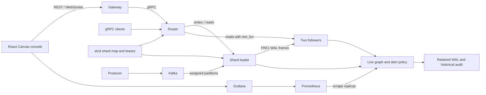
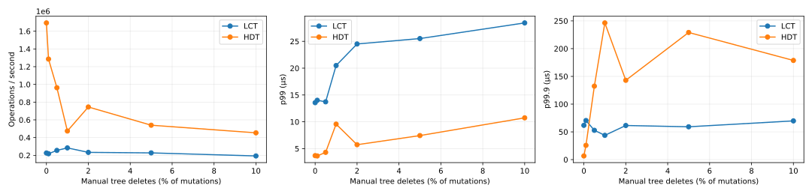
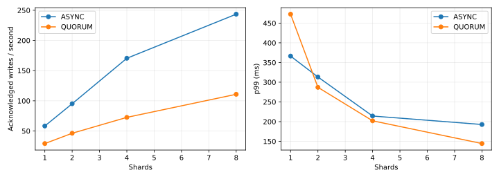
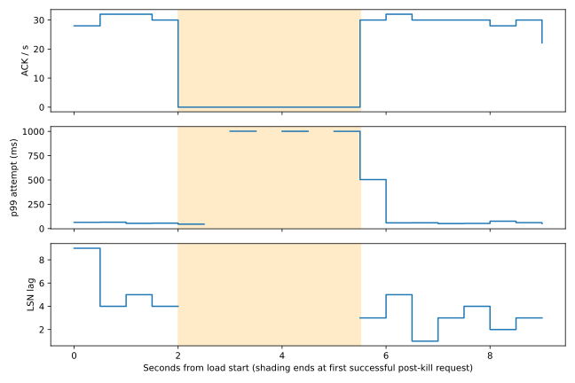

# Streaming fraud-ring detection engine


Shared cards, devices and transactions connect accounts in a per-tenant graph. The live service maintains component size, volume and flagged-account counts as links change or expire. An investigator can follow an alert to the current graph or reconstruct the component at its first historical alert crossing.



**Run the console** with `docker compose up -d --build`, open [Ringwatch](http://localhost:8180), then choose **Seed demo ring** in Live Alerts.

**Reproduce the benchmarks** with Python 3, Matplotlib (`python -m pip install matplotlib`), Git and Docker Compose v2. Run this command in a checkout of the revision in [run.json](bench/results/run.json) to measure the same code. The command builds the Release executable, starts the Compose broker, runs CTest with Kafka enabled, samples both engine profiles, launches disposable replicated clusters, and writes CSVs and plots into `bench/results/`.

```sh
python bench/reproduce.py
```

### Measured results

Release build on one 12-vCPU Docker Desktop Linux VM with 3.49 GiB RAM allocated. The tables use the run from commit `b7701f5`. The bounded matrix reports operations per second, including component queries.

| Workload · 1,000 vertices | BFS | Batch DSU | LCT-MSF | HDT |
| --- | ---: | ---: | ---: | ---: |
| Random sparse | 79,236 | 1,174,230 | 499,886 | 639,600 |
| Preferential attachment | 78,819 | 1,739,730 | 443,118 | 648,942 |
| Bridge cuts | 123,965 | 2,151,940 | 322,797 | 2,895,100 |
| 90% TTL extensions | 123,362 | 6,134,550 | 631,420 | 2,623,320 |
| 40 ms TTL | 86,172 | 1,282,560 | 516,570 | 908,460 |
| 10 arrivals / logical ms | 117,738 | 2,545,570 | 518,649 | 1,231,150 |

**Deletion sweep, 50,000 vertices.** HDT delivered higher throughput and lower p50 and p99 latency at all seven measured fractions. At p99.9, HDT had the lower latency at 0% and 0.1%. LCT first had the lower latency at 0.5% and retained it through 10%. This places the observed change between 0.1% and 0.5%; there are no samples inside that interval.

| Manual deletes | LCT ops/s | HDT ops/s | LCT p99 µs | HDT p99 µs | LCT p99.9 µs | HDT p99.9 µs |
| ---: | ---: | ---: | ---: | ---: | ---: | ---: |
| 0% | 226,345 | 1,693,490 | 13.568 | 3.697 | 61.784 | 6.603 |
| 0.1% | 217,909 | 1,285,610 | 14.018 | 3.637 | 70.441 | 25.692 |
| 0.5% | 255,548 | 962,457 | 13.727 | 4.309 | 52.806 | 132.395 |
| 1% | 283,796 | 474,286 | 20.491 | 9.569 | 43.718 | 246.373 |
| 2% | 233,377 | 745,233 | 24.51 | 5.732 | 61.493 | 142.946 |
| 5% | 227,452 | 539,657 | 25.521 | 7.435 | 59.148 | 229.149 |
| 10% | 193,019 | 453,780 | 28.437 | 10.741 | 69.79 | 178.748 |



At 10%, LCT scanned 500,000 split-side vertices across 4,000 repairs. HDT traversed 4,800 levels and promoted 30,950 edges. None of these bridge cuts had a crossing replacement. Memory use and CPU stacks for the same topology are in [PROFILING.md](PROFILING.md).

**Distributed writes.** Each row measures eight clients issuing updates through the Router to three-member shards.

| Shards | ASYNC writes/s | ASYNC p50 / p99 ms | QUORUM writes/s | QUORUM p50 / p99 ms |
| ---: | ---: | ---: | ---: | ---: |
| 1 | 58.25 | 58.99 / 366.27 | 29.15 | 264.88 / 472.68 |
| 2 | 95.14 | 33.58 / 313.27 | 46.23 | 175.59 / 287.02 |
| 4 | 170.48 | 19.80 / 214.18 | 72.56 | 112.60 / 202.04 |
| 8 | 243.54 | 13.56 / 192.69 | 110.81 | 62.26 / 144.34 |



The first QUORUM request started after the leader kill and successfully acknowledged by its successor completed **3.513 s after the kill**. Four attempts failed during failover. Seven consecutive half-second bins contained zero acknowledgements. The largest sampled follower lag before the kill was nine records. [Time series and individual requests](bench/results/README.md)



### Tenant graph and engines

The single writer accepts typed vertex updates, edge upserts, deletes and ticks. Each accepted command returns its ordered event records and alerts. Queries provide connectivity, component aggregates and bounded induced subgraphs. Hub suppression is a signal-quality policy. Queries report hub-filtered connectivity, while active degree counts all live incident keys.

```sh
docker build -f Dockerfile.dev -t fraud-ring-dev .
docker run --rm -w /workspace/build fraud-ring-dev ctest --output-on-failure
docker run --rm fraud-ring-dev ./build/phase1_bench
```

For a library consumer, instantiate `fraud::Tenant<fraud::BruteForce>` from `core/tenant.hpp` and `engines/brute_force.hpp`. Pass the epoch, first available shard LSN, monotonic event time and command to `submit`. Advance the next LSN by the number of returned records. Use `engine().stats(id)`, `engine().connected(u,v)` and `subgraph(id,max_k)` for queries. The reference engine runs BFS on each query.

Engine A builds an immutable offline index with `OfflineEngine::build(tenant, policy, records, end_ms)` from `engines/offline.hpp`. Supply complete ordered tenant records beginning at empty state, including explicit expiry and hub transitions. The end time is exclusive. Records sharing a timestamp produce one observable historical state after the final record at that timestamp.

Each structural edge lifespan and vertex weight interval occupies a set of segment-tree nodes covering its time range. Traversal applies their unions and weight changes on entry and rolls the DSU back on exit. A query at a leaf sees precisely the intervals covering that timestamp.

Use `audit_at(time, vertex, max_nodes)` for component stats, an induced subgraph and the earliest qualifying timestamp for that vertex. Qualification follows the alert thresholds independently of emission cooldown. `connected_at(time, u, v)` checks historical connectivity. Use `audit_many(queries)` for checkpoints across a trace so they share a segment-tree traversal. Each call initializes vertex-sized rollback workspace and applies the interval actions on visited paths.

Engine B is available as `Tenant<LctEngine> graph(tenant_id, policy, LctEngine(vertex_capacity))` with `engines/lct.hpp`. The fixed capacity counts distinct vertices ever admitted. A rejected capacity increase leaves the tenant state intact. Its maximum spanning forest orders edges by expiry and handle. Manual and suppression cuts search the smaller tree for the best replacement. Ordered expiry uses a direct cut. The slab bound of `2V - 1` covers LCT nodes. The live edge index and adjacency lists also use memory proportional to the number of structural edges. LCT queries adjust preferred paths, so callers must serialize access to an instance.

Build the development image and run the two Phase 3 gates from the repository root. The bind mount retains a failure trace if a mismatch occurs.

```sh
docker build -f Dockerfile.dev -t fraud-ring-phase3 .
docker run --rm -v "${PWD}:/traces" -w /traces fraud-ring-phase3 /workspace/build/phase3_fuzz tier1
docker run --rm -v "${PWD}:/traces" -w /traces fraud-ring-phase3 /workspace/build/phase3_fuzz tier2
```

Each tier accepts an optional numeric seed. On a mismatch the runner removes groups of input mutations and then individual mutations while preserving the failing check. The resulting trace is 1-minimal under single-mutation deletion. Its header records the tier and seed. Each line includes the original generator step and decoded command. Run `/workspace/build/phase3_fuzz replay TRACE` in the same image and mounted directory to reproduce it.

Engine C is available as `Tenant<HdtEngine> graph(tenant_id, policy, HdtEngine(vertex_capacity))` with `engines/hdt.hpp`. It maintains one Euler tour forest per HDT level. Each admitted vertex has a permanent self-loop at each level. Level zero owns the fraud weights. Exact-level flags locate tree edges and incident non-tree edges for replacement searches. Deleting any structural edge uses the same HDT path for manual, expiry and suppression events. A graph self-edge remains visible in the tenant subgraph and cannot cross a cut.

Run `phase4_fuzz tier1` and `phase4_fuzz tier2` in the development image to verify Engine C. Tier 1 runs the 100,000-mutation workload plus 8,192 adversarial mutations. Tier 2 compares full probed components and connectivity online after every input batch, with Engine A at sampled checkpoints. Both tiers use the same trace-reduction and replay interface as Phase 3.

### Single-node service

The Linux service uses HDT by default. Select LCT with `--engine lct`. The following commands publish gRPC and Prometheus on the host loopback interface and keep state in a Docker volume.

```sh
docker build -f Dockerfile.dev -t fraud-ring-phase5 .
docker run --rm -p 127.0.0.1:50051:50051 -p 127.0.0.1:9091:9091 -v fraud-ring-data:/data fraud-ring-phase5 ./build/fraud_server --data /data --listen 0.0.0.0:50051 --metrics-address 0.0.0.0
```

Use [the public protobuf contract](proto/fraud_engine.proto) for clients and scrape `http://127.0.0.1:9091/metrics`. The service exposes all nine public RPCs over plaintext gRPC. A successful mutation returns its durable frame boundary. Concurrent requests can share one fsync. A retried producer sequence returns the current durable watermark with `duplicate=true`. Unknown vertices return false for connectivity and `NOT_FOUND` for stats, subgraph and audit. Live subscribers receive committed alerts from subscription onward. A subscriber that falls behind the 4,096-alert buffer receives `RESOURCE_EXHAUSTED`.

The writer assigns monotonic event times and ticks active tenants every 100 ms, including tenants with no new requests. Adjust the interval with `--tick-ms`. The default snapshot interval is 60 seconds and is configurable with `--snapshot-ms`. One process owns each data directory. A storage failure makes the shard unavailable until restart.

`active.wal` contains little-endian FRE1 frames with IEEE CRC32. Recovery checks the 16 MiB payload and 65,536-record limits before allocating. It repairs a torn active tail and refuses interior damage, unsupported versions, and damaged sealed archives. The FRS1 snapshot contains a versioned canonical protobuf payload and CRC32. Snapshot publication syncs the temporary file and its directory before the covered active segment is renamed to an archive. Startup reads retained WAL for historical queries and applies only the suffix after the snapshot to the live graph.

Phase 5 retains the full audit history on disk and in memory. Each historical query builds Engine A over the requested tenant's prefix. Disk usage and audit cost therefore grow with retained history. The operation histograms measure engine operation time. Separate histograms measure fsync and snapshot duration. The engine-memory gauge counts live index container storage and excludes allocator overhead.

```sh
docker run --rm -w /workspace/build fraud-ring-phase5 ctest --output-on-failure
docker run --rm fraud-ring-phase5 ./build/storage_tests --gtest_filter=Wal.*
docker run --rm fraud-ring-phase5 ./build/phase5_determinism
docker run --rm fraud-ring-phase5 ./build/phase5_smoke
docker run --rm fraud-ring-phase5 ./build/phase5_smoke lct
```

### Replicated shard

An etcd lease and a create-revision compare-and-swap elect the candidate. The transaction revision becomes its epoch. Each member fsyncs a promise before replying and fences older callers. The durable promise and the epoch of the last WAL entry advance independently.

1. Collect promises and log positions from a majority, including the candidate.
2. Select the greatest `(last_entry_epoch, last_lsn)` from that quorum. Find the shared prefix, fetch and verify missing frames, fsync locally and recheck lease ownership.
3. Align followers at a common frame boundary, discard divergent uncommitted suffixes and fsync the authoritative tail on a majority. Truncating committed history is fatal. Rebuild the writer and verify the lease before admitting writes or ticks.

Run one `fraud_replica` process per member with a separate durable directory. Supply the same shard ID, etcd endpoint and three ordered gRPC addresses on each process. The member index is 0, 1 or 2. For example, the first member on a local machine can start with the following command.

```sh
./build/fraud_replica ./data0 0 0 http://127.0.0.1:2379 3 100 127.0.0.1:5100 127.0.0.1:5101 127.0.0.1:5102 9100
```

The two time arguments are lease TTL in seconds and leader tick interval in milliseconds. The last argument sets the optional HTTP metrics port. Start the other two members with their respective directory, member index and metrics port. Public and internal gRPC share each member's address. This configuration assumes a trusted network and fixed membership.

Read the local role, promised epoch, last entry epoch, last LSN and commit LSN with `GetClusterHealth`. Route writes to the member reporting `LEADER`. The default acknowledgment mode is `QUORUM`. Setting `mode=ASYNC` permits local durability during a peer partition. A later election can discard that suffix. Pass `min_lsn` on a read to receive `UNAVAILABLE` while a replica is behind. Successful reads return the applied watermark and role in both the response and gRPC trailing metadata.

Replicas retain FRE1 frames for catch-up and historical audit. Recovery restores the latest available committed checkpoint and replays the remaining frames. Disk usage, replay time and in-memory log storage grow with history length. The chaos suite starts independent replica processes with disposable directories and gives each peer and lease connection a controllable TCP proxy. Run it in Compose with a dedicated etcd service.

```sh
docker compose -f compose.phase6.yml up --build --abort-on-container-exit --exit-code-from chaos
docker compose -f compose.phase6.yml down
```

### Routing and Kafka ingestion

Start three replicas per shard. Store the placement document at the etcd key `/shard_map`. Each index in `partitions` is a Kafka partition number and its value is the shard ID. Member addresses use the same order as the replica command line.

```json
{
  "partitions": [2, 0, 3, 1, 2, 0, 3, 1],
  "pins": {"101": 1},
  "members": {
    "0": ["s0a:5100", "s0b:5100", "s0c:5100"],
    "1": ["s1a:5100", "s1b:5100", "s1c:5100"],
    "2": ["s2a:5100", "s2b:5100", "s2c:5100"],
    "3": ["s3a:5100", "s3b:5100", "s3c:5100"]
  }
}
```

```sh
ETCDCTL_API=3 etcdctl --endpoints=http://etcd:2379 put /shard_map < placement.json
./build/fraud_router http://etcd:2379 0.0.0.0:5200
./build/fraud_produce http://etcd:2379 broker:9092 fraud-mutations < mutations.jsonl
```

The producer accepts one protobuf-JSON `KafkaMutation` per line, for example `{"update":{"tenant_id":"101","vertex_id":"42","volume":"120","source":{"producer_id":"9","sequence":"1"}}}`. It sends protobuf bytes to the partition returned by `Topology::partition`. Unpinned tenants use 64-bit FNV-1a on the eight little-endian bytes of their unsigned ID, modulo the partition count. Provision the topic with that count. The router and ingestion workers read the map and election keys at a single etcd revision, refreshed on demand after 150 ms. Moving existing tenant state across shards requires draining producers and transferring history before changing placement.

Set `FRAUD_KAFKA_BROKERS` on each replica to enable ingestion. All replicas use the same `FRAUD_KAFKA_TOPIC` (default `fraud-mutations`) and `FRAUD_KAFKA_GROUP` (default `fraud-ingest`). Leaders assign their partitions after reconciliation. Every Kafka mutation needs a producer ID and monotonically increasing sequence per tenant/producer pair. Deliver each pair in sequence order. Use the same source identity across Kafka and gRPC to deduplicate cross-channel retries.

`FRAUD_KAFKA_ACK` defaults to `QUORUM`. With `ASYNC`, an offset can cover a locally fsynced entry that a later election discards. `FRAUD_OFFSET_COMMIT_MS` sets the offset flush interval (default 250 ms). Replicas atomically checkpoint committed state, including producer high-water marks, every `FRAUD_CHECKPOINT_FRAMES` frames (default 4096). Restart loads the checkpoint and applies the committed suffix. Historical audit and peer reconciliation retain the full WAL.

Admissions include the running writer. `FRAUD_PENDING_REQUESTS` defaults to 256, `FRAUD_PENDING_BYTES` to 1048576 and `FRAUD_REPLICATION_LAG` to 16384 locally durable records beyond the majority commit watermark. A full limit returns `RESOURCE_EXHAUSTED`. Kafka pauses its assigned partitions while retaining the pending message. The metrics endpoint exposes `shed_requests_total`, `ingestion_queue_depth`, `ingestion_pending_bytes`, `kafka_pause_total`, `kafka_resume_total` and `kafka_offset_commits_total`.

```sh
docker compose -f compose.phase7.yml up --build --abort-on-container-exit --exit-code-from gate
docker compose -f compose.phase7.yml down
```

The same test is registered with CTest as `Sharding.FourShardKafka`. Set `FRAUD_TEST_BROKERS` to run it against a reachable broker. It creates a unique topic and consumer group.

### Operations console

Run `docker compose up -d --build` and open [Ringwatch](http://localhost:8180). Compose starts four groups of three replicas, the Router, etcd, Redpanda, Prometheus, Grafana, the gateway and the production Vite build. Only the console port is published, on loopback. Set `CONSOLE_PORT` to change it.

In **Live alerts**, wait for the stream to connect and choose **Seed demo ring**. The generator submits seven accounts, two shared cards, one shared device and transfers to the Router. Select the alert to inspect its Canvas graph. **Audit time travel** opens at its event timestamp. The feed retains the newest 200 events received in the current browser session. Reconnecting starts a new live subscription.

All data requests from the gateway use the Router gRPC service. IDs, timestamps, volumes and LSNs retain their unsigned 64-bit precision as decimal strings.

| Endpoint | Operation |
| --- | --- |
| `GET /api/components/:tenant/:vertex/stats` | Component stats and observed lag in records relative to a subsequent leader sample |
| `GET /api/components/:tenant/:vertex/subgraph?max_nodes=2000` | Bounded component graph |
| `GET /api/audit/:tenant/:vertex?timestamp_ms=…&max_nodes=2000` | Historical graph, stats and first alert crossing |
| `GET /api/cluster/health` | Shard and replica topology |
| `WS /api/alerts/stream?tenant=1` | JSON packets with type `ready` or `alert`; alert packets carry the Router event in `event` |
| `POST /api/dev/seed-demo` | Seed the tenant given in the JSON body (default tenant 1) |
| `POST /api/dev/kill-leader/:shard` | Stop the elected replica process; an optional JSON `epoch` fences the request |

Component and audit reads accept an optional `min_lsn`. The local Compose demo enables the development controls. Set `FRAUD_DEV_MODE=0` before starting Compose to disable them at both gateway and replica. A stopped replica can rejoin with `docker compose start s0r0` (use the member address shown on the shard card).

```sh
docker compose exec -w /workspace/build -e FRAUD_TEST_BROKERS=broker:9092 router ctest --output-on-failure
python -m pip install playwright
python -m playwright install chromium
python bench/phase8_e2e.py --failover --canvas-limit
```

The browser gate uses the running Compose stack. The optional failover check restores the stopped member. The canvas-limit check writes a 2,001-account chain to a fresh tenant through Kafka and measures 60 browser frame intervals on the bounded graph.

### Kubernetes and observability

The Kustomize entry point is `deploy/`. Each shard has a three-member StatefulSet with stable DNS identities, a headless Service and a separate persistent volume claim per replica. The etcd and Redpanda StatefulSets also require a default storage class. Placement and topic initialization run as Jobs. The console Service stays internal until forwarded. For a local kind cluster:

```sh
kind create cluster --name ringwatch
docker build -t fraud-ring-phase9 -f Dockerfile.dev .
docker build -t ringwatch-gateway -f gateway/Dockerfile .
docker build -t ringwatch-console -f console/Dockerfile .
kind load docker-image --name ringwatch fraud-ring-phase9 ringwatch-gateway ringwatch-console
kubectl apply -k deploy/
kubectl rollout status statefulset/shard-0
kubectl port-forward service/console 8180:80
```

The Kubernetes configuration disables the demo mutation controls. Use the gRPC Router or Kafka producer to submit events. Prometheus scrapes each replica. Grafana provisions both the console latency panel and [the full engine and replication dashboard](deploy/grafana/dashboard.json). Empty histogram panels require observations in their selected interval. In this release the manifests were rendered with `kubectl kustomize deploy`; runtime deployment and failover were exercised on Docker Compose.

### Measurement boundaries

The engine matrix uses 1,000 vertices so BFS and full DSU rebuilding can consume the same trace as the dynamic engines. The DSU unions inserts incrementally and batches removals until the next component query, when it rebuilds from all live edges. Every expiry window ends with a query. The sparse and hub workloads add five short-lived chords per logical millisecond for 200 ms, expire them after 10 ms, and drain the tail. The hub workload uses degree-weighted endpoints. Two sensitivity runs independently vary TTL to 40 ms and arrival rate to ten new chords per logical millisecond. These are simulated event times. The repeat workload extends TTLs on exactly 90% of mutations. The adversarial workload repeatedly cuts and reinserts the central bridge of a 1,000-vertex component. Handles identify structural edges directly. This isolates the graph index from tenant policy, network and persistence costs.

The crossover sweep uses 50,000 vertices in 200 independent 250-vertex components. Each manual deletion targets a randomly selected component's central tree bridge. Each deletion is followed by reinsertion. There are 40,000 mutations and 2,500 component queries per engine per point. The fraction counts manual deletions among mutations. Timing includes clock calls and dispatch, excludes graph construction, and pools mutation and query latencies. Percentiles use nearest rank. Each row represents one seeded run. Topology, query mix and machine load can change the ordering.

Distributed runs use eight concurrent clients pinned across the available shards, three replica processes per shard, one gRPC Router and a private etcd. Each mode times 256 acknowledged vertex updates after warm-up. Each client waits for its preceding acknowledgement. ASYNC runs first. The failover trace uses a single QUORUM writer with a one-second deadline per attempt, kills the leader process and restarts it after a successful post-kill request. Half-second bins include failed attempts in latency and only successes in throughput. Lag is the largest observed leader-to-reachable-follower applied-LSN difference; gaps indicate an unavailable observation. [Raw samples, summaries and environment](bench/results/)

### Operational limits

The service assumes trusted peers, fixed three-member groups and ordered sequences per producer. Tenant migration requires coordinated history transfer. Historical audit and reconciliation retain WAL history, so storage and recovery work grow over time. ASYNC can lose a locally acknowledged suffix on failover. The supplied Compose and kind configurations use a single etcd and broker and provide no infrastructure-level high availability or transport authentication. The archived distributed benchmarks use loopback networking and a shared Docker host and disk. They measure this configuration; multi-host latency, sustained saturation and physical-disk power-loss behavior require separate measurements.
